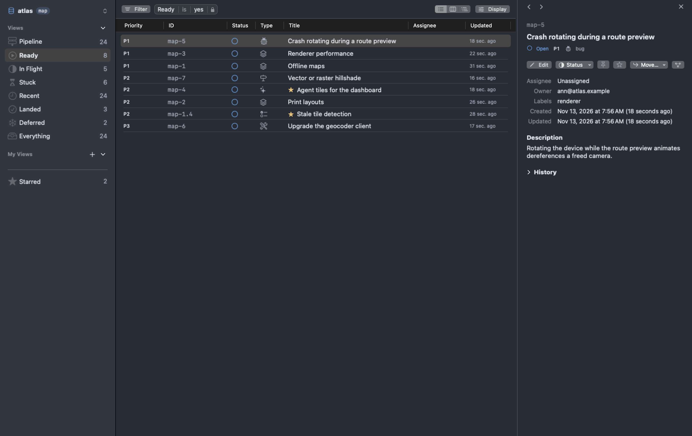

<h1 align="center">Beady</h1>

<p align="center">
  A native macOS app for seeing what a <a href="https://github.com/steveyegge/beads">beads</a>
  (<code>bd</code>) database is doing — and changing it without holding your breath.
</p>

<p align="center">
  <a href="https://dvhthomas.github.io/beady/"><strong>Website</strong></a> ·
  <a href="https://dvhthomas.github.io/beady/guide/"><strong>User guide</strong></a> ·
  <a href="https://github.com/dvhthomas/beady/releases/latest"><strong>Latest release</strong></a>
</p>



Beads is an issue tracker built for agents: dependencies are first class, and several agents may
be writing to the same database while you read it. Beady is the window onto that. It reads with
`bd --readonly`, watches the database so the view is never stale, and puts every write behind
validation, a preview of the exact `bd` commands, and a read-back check.

## Install

You need macOS 15 or later and `bd` on your PATH (`brew install beads`).

```bash
brew install --cask dvhthomas/beady/beady
```

The app is ad-hoc signed, not notarised, so the first launch needs **Open Anyway** in System
Settings → Privacy & Security. [Install and first launch](https://dvhthomas.github.io/beady/guide/install/)
covers that, Intel Macs, downloading a release and building from source.

## What it does

- **[Views that answer questions](https://dvhthomas.github.io/beady/guide/views/)**: Ready, In
  Flight, Stuck, Pipeline and more in the sidebar, filters that read as chips, and views of your
  own to save and share.
- **[Lists, boards and trees](https://dvhthomas.github.io/beady/guide/layouts/)**: a resizable
  table, a board you can drag between, and a tree that keeps ancestors visible.
- **[What's in the way](https://dvhthomas.github.io/beady/guide/dependencies/)**: blockers named
  on the row, and the whole dependency graph on ⌘G.
- **[Careful changes](https://dvhthomas.github.io/beady/guide/changes/)**: nothing is written
  until you confirm a sheet showing the change and the commands, beside agents writing to the
  same database.
- **[Everything from the keyboard](https://dvhthomas.github.io/beady/guide/keyboard/)**: ⌘P runs
  any command or jumps to a bead.
- **[Themes and languages](https://dvhthomas.github.io/beady/guide/themes/)**: eight themes with
  tested contrast, four text sizes, seven languages.

## Developing

```bash
git clone https://github.com/dvhthomas/beady.git
cd beady
scripts/test.sh                              # the test suite
scripts/bundle.sh && open build/Beady.app    # build and run
```

[docs/DEVELOPING.md](docs/DEVELOPING.md) has the architecture, the tests, and how the website
and its screenshots are built. [RELEASE.md](RELEASE.md) explains releases: every merge to master
is one. Translations are welcome; see [docs/LOCALIZATION.md](docs/LOCALIZATION.md).

## Licence

MIT. See [LICENSE](LICENSE).
