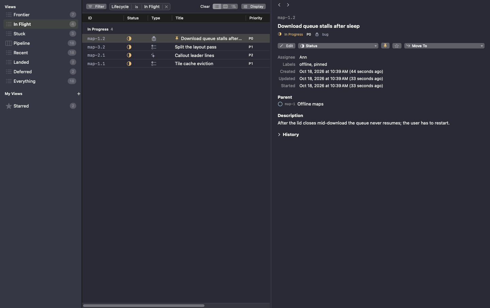
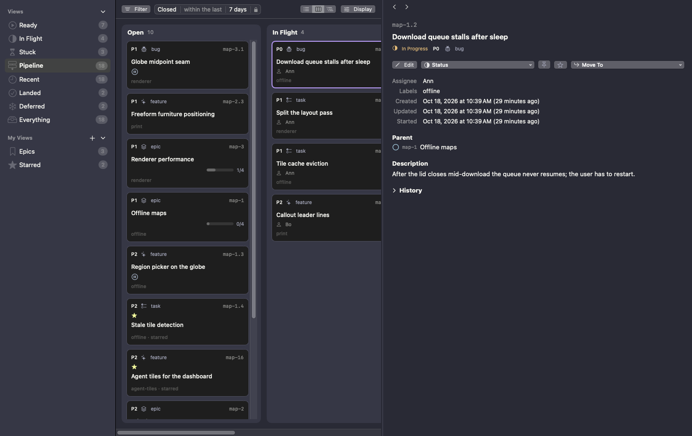
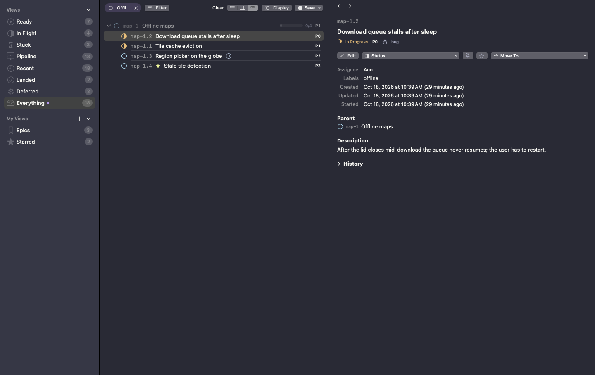
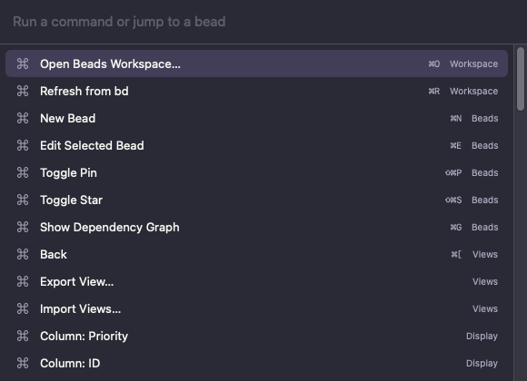
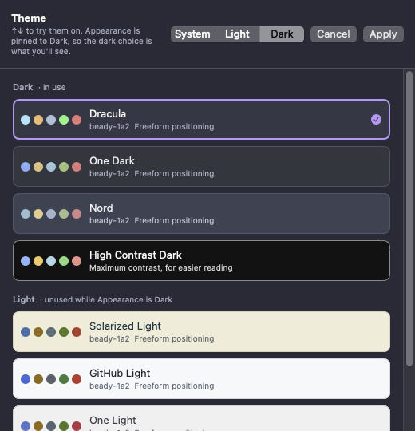
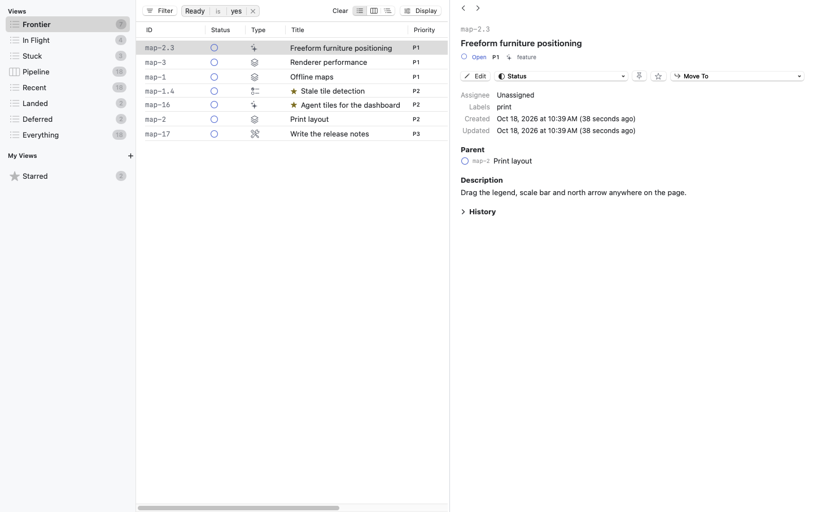
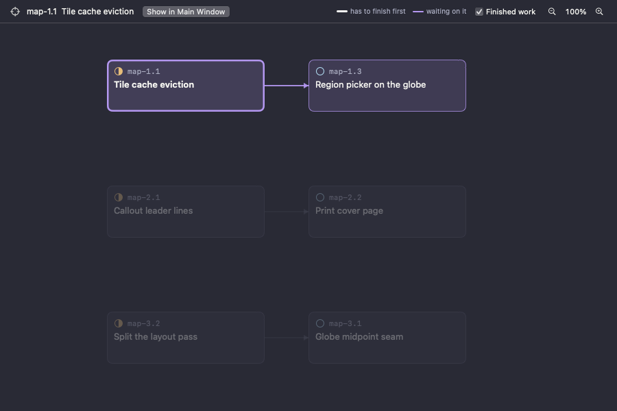
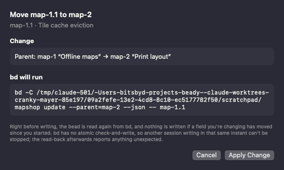

<h1 align="center">Beady</h1>

<p align="center">
  A native macOS app for seeing what a <a href="https://github.com/steveyegge/beads">beads</a>
  (<code>bd</code>) database is doing — and changing it without holding your breath.
</p>



Beads is an issue tracker built for agents: dependencies are first class, and several agents may
be writing to the same database while you read it. Beady is the window onto that. It reads with
`bd --readonly`, watches the database for changes so the view is never stale, and puts every write
behind validation, a preview of the exact `bd` commands, and a read-back check.

The screenshot above is the In Flight view: work grouped by status, the pinned P0 bug on top, and
the details of the selected bead — including what it's holding up — alongside. The sidebar is
views, each with an icon that says what it answers; the chip that defines In Flight is locked.

## What it's for

- **See the shape of the work.** Every entry in the sidebar is a view: a saved filter with a saved
  layout, grouping and ordering. The built-ins answer the questions you actually ask — **Pipeline**
  (everything live plus a week of done, as a board), **Ready** (what can start now), **In Flight**,
  **Stuck** (what's blocked), **Recent**, **Landed**, **Deferred**, **Everything** and **Starred** —
  and your own views sit under them. A built-in's own rules are locked chips; add one on top and
  a dot says it's modified, to save as a new view or reset. Duplicate a built-in to change what
  it means.
- **Filter the way you think.** Pick a property, tick values; rules read as chips —
  `Priority · is any of · P1, P2 · ✕` — and combine with AND.
- **Three ways to look.** A resizable table, a tree that keeps ancestors visible, and a board you
  can drag between.
- **Keep what matters in front of you.** Pin a bead (⇧⌘P) and it leads every list, tree and board
  column; star one (⇧⌘S) and it collects in the Starred view. Both are bd labels, so `bd list
  --label pinned` sees exactly what Beady sees. The mark appears at once and is written behind
  it — a bd write costs the better part of a second — and if the write fails the mark goes back
  and the Changes menu says why.
- **Ask what's in the way.** bd's "blocked" means something upstream has to land first, so Beady
  says so rather than sounding an alarm: a quiet waiting mark, a **Blocked by** column (on by
  default in Stuck) naming the blocker, and a details section with the chain grouped into "start
  now" and "then". ⌘G opens the whole dependency graph in its own window.
- **Know what bd's words mean.** Ready, Blocked, Deferred, Pinned, Hooked and the lifecycle
  categories each mean something exact in bd. Hover a view, a chip, a filter value or a status and
  the tooltip says what, in bd's own words.
- **Keep and share views.** Your views live as one `.beadyview` file each in
  `~/Library/Application Support/Beady/views`, so they follow you and `cp` works. Export… writes
  one, Share… hands it to AirDrop or Messages, and double-clicking a `.beadyview` in Finder — or
  dropping it on the sidebar — imports it under My Views.
- **Change things carefully.** Nothing is written until you confirm a sheet showing the change,
  its warnings, and the commands themselves.

| | |
|---|---|
|  |  |
| Pipeline — a board of everything live plus a week of done; drag between columns, and the grouping decides what a drop means | Tree — focused on one bead, ancestors kept visible when a filter matches a child |

## Everything from the keyboard

`⌘P` runs any command or jumps to a bead by id or title — and it really is any command: views,
filters, layouts, columns, themes, text size, pins, stars, focus, back and forward, saving and
resetting a view, settings. It answers to the words you'd actually type: `fin` finds Find,
`kanban` finds the board, `drac` finds the theme.



`/` search · `F` filter · `⇧V` display · `⌘T` theme · `⌘N` new bead · `⌘E` edit · `⌘G` graph ·
`⇧⌘P` pin · `⇧⌘S` star · `⌘S` save view · `⌥⌘S` save as new view · `⌥⌘R` reset view ·
`⌘I` details · `⌘1/2/3` layout · `⌘R` refresh · `?` the full list.

## Themes, and eyes that need help





System, light or dark, with the best-known editor themes on both sides — Dracula, One Dark, Nord,
Solarized Light, GitHub Light, One Light — plus a high-contrast pair that macOS's own
**Increase Contrast** setting switches to on its own. Text scales from Small to Extra Large.

A theme paints the whole window — sidebar, list, board, details and the title bar — the way Linear
and VS Code do, rather than tinting the content and leaving system grey around it. The trade is
macOS's translucent sidebar material, which a themed sidebar can't keep.

⌘T opens the picker: arrow up and down and the whole app repaints as you go, so you judge a theme
by the app rather than by six coloured dots. **Apply** keeps the one you stopped on; Cancel or
Escape puts back what you had.

Every colour in the app is a design token, and the contrast of every theme is checked by tests:
body text clears WCAG AA (4.5:1) on both the background and a row, status and priority colours
clear 3:1, and the high-contrast themes clear AAA (7:1).

## The dependency graph



⌘G opens every `blocks` dependency in the database as one graph, read left to right the way
`bd graph` reads: what can start now on the left, what waits on it further right. Click any bead
to follow it — the view recentres on it, draws everything it's waiting on in bold, tints
everything waiting on it, and lets the rest fade. Selecting a bead in the main window moves the
graph too, and **Show in Main Window** goes the other way. Finished beads are drawn struck
through, and a checkbox hides them; ⌘+ and ⌘− zoom.

## Writing to a live database



bd has no lease or lock, and agents write whenever they like, so Beady is built to be one writer
among several:

- **Validation** against the loaded data — titles, priorities, known statuses and types, parents
  that exist, no parent loops. Closing needs a reason; bd's own rules (no closing pinned beads or
  epics with open children) are respected.
- **A conflict check** immediately before writing, comparing what you saw with what's in bd now.
- **The exact commands**, shown before you agree to them.
- **A read-back** afterwards. If anything goes wrong, the result is resolved into landed, failed or
  uncertain by re-reading — never guessed.
- **Live-work warnings.** If another actor touched a bead recently (bd's events journal, which
  Beady turns on, or its interaction log before bd 1.3), the row is marked and the confirmation
  sheet says so. It informs; it never blocks, because a lock bd doesn't offer can't be faked.

## Backing it up

The toolbar says whether this database could be recovered — "backed up 6 min ago", or "not backed
up" — and clicking it either backs up now or asks for a folder. Underneath it's `bd backup`, which
is a Dolt-native push: tables, branches and history, not just the issues. (`bd export` writes
JSONL for interchange and is explicitly *not* a backup.)

Pick a folder that something already carries off the machine — Time Machine, iCloud Drive, a
synced disk. Restoring is a two-step CLI job by design, since it replaces a database:

```bash
bd init                         # if the workspace is empty
bd backup restore /path/to/backup --force
```

## Install

Requirements: macOS 15 or later, and `bd` on your PATH.

**Build it yourself** — recommended, because an app you build is never quarantined. You also need
a Swift 6 toolchain, from Xcode or the Command Line Tools:

```bash
git clone https://github.com/dvhthomas/beady.git
cd beady
scripts/bundle.sh && open build/Beady.app
```

**Or download a release.** Take the zip from
[Releases](https://github.com/dvhthomas/beady/releases), unzip, and move Beady to /Applications.
It's ad-hoc signed but not notarised — there's no Apple Developer ID behind it — so macOS
quarantines it the first time. Either open it and choose **Open Anyway** in System Settings →
Privacy & Security, or clear the flag yourself:

```bash
xattr -dr com.apple.quarantine /Applications/Beady.app
```

Open a project folder containing `.beads` (or the `.beads` folder itself) with ⌘O. The last
workspace reopens on launch; `--workspace /path/to/project` overrides it.

## What you can see

- **Views** (sidebar, modelled on Linear, navigation only): a view is a saved filter with a saved
  layout, grouping, ordering and columns, over every bead. The built-ins, each with its total:
  **Pipeline** — everything live plus the last week of done, as a board of lifecycle columns;
  **Ready** — `ready is yes`, bd's ready work: active, nothing open blocking it, not deferred
  to a future date; **In Flight** — bd's wip category; **Stuck** — `blocked is yes`, computed from
  the dependency graph; **Recent** — updated in the last 24 hours, by assignee; **Landed** — done and
  closed in the last week; **Deferred** — bd's frozen category; **Everything**; and **Starred**,
  once something is starred. Open and Closed are one Lifecycle chip away. Categories come from
  `bd statuses`, so custom statuses land in the right place. Each view keeps its own filters,
  search, layout, grouping and ordering, so switching views never carries filters along.
- **Saving views**: a built-in's filter is its definition, so its chips are locked — a lock
  instead of ✕, no operator menu, and *Clear* leaves them — while adding a chip on top shows a
  dot and a **Save** control with *Save as new view…* and *Reset*; its layout, grouping and
  ordering are simply remembered. Right-click a built-in to *Duplicate* it: the copy is yours to
  edit. Your own views, under **My Views**, remember everything and offer *Save* too (⌘S). Each
  has an icon of its own, picked from a small set (bookmark by default) when it's saved or from
  *Change Icon…*; the built-ins ship with theirs, and no row ever shows the layout glyph.
  Right-click a user view to rename, change its icon, duplicate, export, share or delete it; the
  `+` on the section saves the current view under a name. Views are `.beadyview` files (JSON with
  a `beadyView: 1` header) in `~/Library/Application Support/Beady/views`, read at launch and
  watched; a `.beadyviews` file is an array of them. Double-click one in Finder, drop it on the
  sidebar, or use *Import Views…*; a view whose id is already taken comes in under a fresh id.
- **One-column boards**: a board whose grouping would put everything in one column says
  *Nothing to split* and offers the groupings that would spread it out, each a button.
- **Hover help**: every view, filter field, fixed filter value (a status, a window, Ready,
  Blocked), status badge and grouping carries a one-sentence definition in bd's own words.
- **Filter** (button or `F`, in the view header): pick a property, then tick values. The menu
  stays open, and each value shows how many issues you'd see. Rules appear as chips reading
  `Priority · is any of · P1, P2 · ✕`; click the operator to switch between `is` / `is not` (or
  `includes all / any / none` for labels), and the values to change them. Chips are ANDed. The
  fields are Lifecycle (bd's active / wip / frozen / done), Status, Priority, Type, Assignee,
  Labels, Blocked, Ready, Parent, Updated and Closed; `Closed · within · 7 days` keeps every live
  bead and hides done beads older than that, so one chip turns Everything into a working board.
- **Display** (button or `⇧V`): layout (List, Board, Tree), grouping (Lifecycle, Status, Priority,
  Type, Assignee, Parent), ordering, and which columns the list shows.
- **Columns**: the list is a real table — drag the header dividers to resize, right-click the
  header (or use Display) to show and hide columns, including Labels and Progress. Your layout is
  saved between launches; **Reset Columns** puts it back.
- **Focus** (any row's context menu, or the details panel): narrows the current view to
  everything under that bead, at any depth — for any bead, not just epics. It is a
  `Parent · is · X` chip, shown as a breadcrumb in the header; its ✕ pops it and the view's other
  filters stay. Save while focused and you have "this epic, as a tree" as a view of its own.
- **Layouts**: List (a table with section headers per group), Board (a column per group, lifecycle
  when ungrouped), and Tree (parent/child outline, expanded by default, with completion;
  right-click to expand or collapse all).
- **Search** narrows the current view: every word must appear in the id, title, description,
  notes, labels or close reason.
  - Different facets are ANDed.
  - Within a single-valued facet (type, status, priority, assignee) the picked values are
    alternatives, because an issue has exactly one of each.
  - Labels are multi-valued, so every selected label is required.
  - Every search word must appear somewhere (id, title, description, notes, labels, close reason).
- **Tree context**: when a filter matches a child, its ancestors stay visible (dimmed) so nothing
  appears orphaned.
- **Details inspector**: metadata, parent / blocked-by / blocks / children links, description and
  notes (inline Markdown), close reason, the unblock path when something is in the way, and a
  **History** expander built from `bd history` — bd records a commit per change, so Beady diffs
  consecutive versions into "status · open → in_progress" and names the actor from bd's
  interaction log.
- **Pins and stars** are bd labels (`pinned`, `starred`), never app-only state. Note bd also has a
  built-in `pinned` *status*, which is a different thing: the label is Beady's "show me first".
- **Auto-refresh**: the app watches the `.beads` folder with FSEvents and reloads within a moment
  of any write — yours or an agent's — falling back to a 15-second check. Nothing is opened or
  written to do it. ⌘R reloads on demand.
- **Other sessions**: bd has no lease or lock, so when another actor changed a bead recently
  the details panel says who and when, the row is marked, and a change to that bead carries a
  warning on the confirmation sheet. It informs; it never blocks.
- **bd's events journal** (bd 1.3 and later): Beady checks bd's version when a workspace opens.
  If the journal is off and the workspace is writable, Beady turns it on with one
  `bd config set-many`, listed under **Changes** with the workspace named and an **Undo** that
  writes it back off. It's a workspace setting, so every bd command there (agents' included)
  records to it from then on; Beady also shortens bd's week-long retention to a day where bd's
  defaults still stand, and leaves alone a retention someone chose. With it on, each change is
  attributed from the journal. With it off, or an older bd, Beady reads `.beads/interactions.jsonl`
  as before, which bd 1.3 writes only when `audit.enabled` is set. The setting "Turn on bd's
  change journal in workspaces that don't have it" (⌘,) switches the automatic part off; a
  workspace where the journal was turned off after Beady turned it on is left off either way,
  and ⌘P → "Turn On bd's Change Journal" is there for a change of mind. Read-only workspaces are
  never written to. See [docs/plans/0003-events-journal.md](docs/plans/0003-events-journal.md).

## Architecture

```
Beady (app target)      SwiftUI views + AppSession composition root
   │            │
   ▼            ▼
BeadsPresentation   BeadsData     WorkspaceModel (per-view state) │ BDGateway + BDStore
        │               │
        └──────► BeadsCore ◄──────┘  Issue, IssueSnapshot, Scope, IssueFilter,
                                     IssueQuery, IssueTree, IssueBoard  (pure, no I/O)
```

- **BeadsCore** is the domain: the snapshot, lifecycle scopes, Linear-style view filtering
  (`ViewSource`, `FilterRule`, `ViewFilter`, `FilterOptions`, `IssueGrouping`), sorting, tree
  building (cycle-safe), and the change pipeline (`IssueChange`, `ChangeValidator`, `ChangeGuard`,
  `ChangeRunner`). It defines the single `BeadsStore` port.
- **BeadsData** implements that port. Every bd invocation is a typed `BDCommand` run by one
  `BDGateway`, which also owns the change token and workspace detection. Reads always carry
  `--readonly`; the only writes are `update`, `close`, `reopen` and `create`. `BDStore` implements
  `BeadsStore` purely through the gateway, and an architecture test keeps it that way. Underneath:
  locating `bd` (Finder-launched apps get a minimal PATH), non-blocking pipe draining, timeouts and
  cancellation that escalate SIGTERM to SIGKILL (bd traps SIGTERM), and per-record JSON decoding.
- **BeadsPresentation** holds all view state and decisions in a UI-framework-free `@Observable`
  model, so it's unit-tested without SwiftUI.
- **Beady** is thin SwiftUI plus the composition root.

### Why the bd CLI rather than reading Dolt directly

bd owns its storage: embedded or server Dolt, schema migrations, and derived fields (`parent`,
dependency types, status categories). Reading Dolt tables directly would couple the viewer to
bd's internal schema and need a MySQL-protocol client or the Dolt engine embedded in the app.
One `bd --readonly list --json --all --limit 0 --flat` returns the whole database (about 0.3s for
~70 issues), and all filtering happens in memory, which keeps the UI instant. The loader sits
behind a protocol, so a direct Dolt adapter can replace it later without touching the rest.

### Change detection

Polling every 2s compares a fingerprint of `.beads/last-touched`, `.beads/issues.jsonl` (mtime
and size) and Dolt's `noms` files (**size only**). Even `bd --readonly` bumps the mtime of Dolt's
manifest and journal, so mtimes there would make every reload trigger another. Data older than
five minutes is reloaded regardless, to cover writes the probe can't see (such as a remote Dolt
server).

## Tests

```bash
scripts/test.sh
```

Swift Testing, test-first per layer: domain rules, JSON decoding against realistic bd output, the
CLI loader with a fake runner (asserting it only ever runs `--readonly list` / `statuses`), the
process runner (pipe deadlocks, timeouts), and the presentation model (loading, change-driven
refresh, scope/filter/sort, chips, tree, board).

An opt-in integration test uses the real `bd` against an existing workspace, read-only, and checks
that reading doesn't register as a change:

```bash
BEADY_IT_WORKSPACE=/path/to/project scripts/test.sh
```

A second opt-in test writes through the real bd: it creates epics and a bead, edits it, moves it
between epics, confirms a loop is refused, closes and reopens it, and checks the result. It only
runs against a workspace containing a `.beady-scratch` marker file, so it can't touch a real
project:

```bash
BEADY_IT_WRITABLE_WORKSPACE=/path/to/scratch-project scripts/test.sh
```

`scripts/test.sh` also passes the Swift Testing macro plugin path when only the Command Line Tools
are installed, since SwiftPM doesn't find it on its own there. For the same reason (no SwiftUI
macro plugin in the Command Line Tools) the views use `State` as a plain stored property rather
than the `@State` macro.

## Not yet

Editing arbitrary labels, assignees and blocking dependencies; comments (`bd comments`); and
graphs wider than one hop around a bead.

## Developing

`scripts/test.sh` runs the suite (it passes the Swift Testing macro plugin path, which plain
`swift test` misses under Command Line Tools). Two opt-in integration suites run against a real
bd when you point them at one:

```bash
BEADY_IT_WORKSPACE=/path/to/project scripts/test.sh            # read-only
BEADY_IT_WRITABLE_WORKSPACE=/path/to/scratch scripts/test.sh   # writes; needs a .beady-scratch marker
```

`BEADY_SNAPSHOT_DIR=/tmp/shots build/Beady.app/Contents/MacOS/Beady --workspace <project>` renders
the main views to PNGs offscreen, which is how UI changes get checked without a window — the
screenshots above were made that way, from a small demo database. `BEADY_VERIFY_KEYS=1` types
into a real window and reports whether the single-key shortcuts and the keyboard focus behave.

`swift scripts/make-icon.swift` redraws `Resources/AppIcon.icns`.

This app's own work is tracked in beads — `bd list` in a clone of your own. The backlog
itself stays on the machine it's worked on; only bd's configuration is committed.

## Licence

MIT. See [LICENSE](LICENSE).
